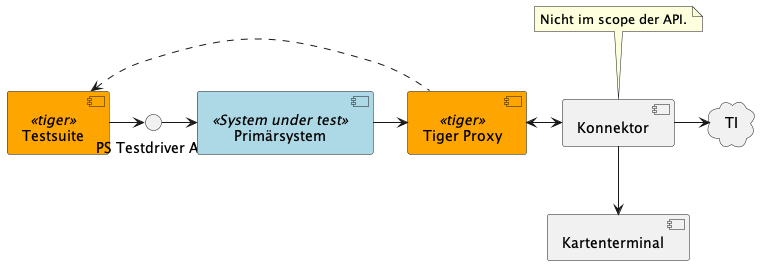

 <br/>

# PS Testdriver API

<details>
  <summary>Table of Contents</summary>
  <ol>
    <li>
      <a href="#about-the-project">About The Project</a>
      <ul>
        <li><a href="#release-notes">Release Notes</a></li>
      </ul>
    </li>
    <li>
      <a href="#getting-started">Getting Started</a>
      <ul>
        <li><a href="#prerequisites">Prerequisites</a></li>
        <li><a href="#installation">Installation</a></li>
      </ul>
    </li>
    <li><a href="#usage">Usage</a></li>
    <li><a href="#contributing">Contributing</a></li>
    <li><a href="#license">License</a></li>
    <li><a href="#contact">Contact</a></li>
  </ol>
</details>

## About The Project

The PS Testdriver API is a REST interface, specified in OpenAPI, that a primary system (Primärsystem, PS) exposes so that
gematik test suites can drive it automatically. It allows a test suite to trigger high-level use cases in the PS
(e.g. "insert an eGK", "retrieve the electronic medication list") and to inspect the resulting state of the PS.

### Motivation

* Some tests, e.g. the download of the electronic medication list (EML), require access to the internal data of the
  primary system.
* gematik test suites can be integrated into the vendors' own processes (CI, regression testing). Smaller vendors in
  particular get a tool to test faster and more easily.
* Testable primary systems are a prerequisite for using the KOB procedure for further applications, and for gematik
  to provide more, and more fine-grained, test suites for primary systems in the future.

### Design principles

The interface ...

* ... should be usable for as many current and future gematik applications as possible.
* ... must be implementable by vendors with as little effort and overhead as possible.
* ... should be robust across a wide range of scenarios.
* ... is described transparently in a public Git repository.
* ... supports iterative extension.
* ... is versioned via media types (e.g. `application/gematik.psTestdriver.v0.3.0+json`). The PS must reject
  request versions it does not support during content negotiation.

Operations are high-level ("retrieve the medication list for this patient", not "perform a VAU login") and are grouped
by use case, not by gematik product or specialist service. An operation may therefore involve several specialist
services. REST was chosen over MQ, SSE or STOMP for simplicity and broad tool support.



### Release Notes

See [ReleaseNotes.md](./ReleaseNotes.md) for all information regarding the (newest) releases.

## Getting Started

### Prerequisites

* For reading the specification: any OpenAPI 3.0 viewer, e.g. [Swagger Editor](https://editor.swagger.io/)
* For generating server stubs with the included Maven configuration: Java 11+ and Maven 3.6+

### Installation

The API specification is the file [psTestdriver.yaml](./psTestdriver.yaml). Implementers of a primary system can
generate server code from it with any OpenAPI generator. The included `pom.xml` shows an example using the
`openapi-generator-maven-plugin` (Spring generator):

```shell
mvn clean compile
```

## Usage

The test suite must be configured with the base URL of the PS Testdriver API of the system under test.

### Operation groups

| Tag         | Meaning                                                                                       |
|-------------|-----------------------------------------------------------------------------------------------|
| Mandatory   | Required for basic operation with any gematik test suite.                                     |
| Optional    | Triggered by the test suite, but not required for a test to pass (respond with `501` if not implemented). |
| KOB EPA 3.0 | Required, together with the mandatory operations, for the KOB EPA 3.0 test suite.             |

### Konnektor configuration

With `POST /system/configuration/konnektor` the test suite can push a Konnektor configuration (`.kon` format) to the
PS, overriding the administrator-set configuration for the duration of the test run. Only the test environments `tu`
and `ru` are accepted; `pu` must be rejected with `400`. `GET /system/configuration/konnektor` returns the current
configuration with all credential secrets masked.

### Asynchronous actions

Operations that may take a long time (e.g. inserting several physical cards) are modelled as *actions*:

1. The test suite sends a `POST` to start the action, e.g. `POST /patient/insert-egk`.
2. The PS answers with `201 Created` and a `Location` header pointing to `/actions/{id}`.
3. The test suite polls `GET /actions/{id}` until the action has finished. No request has to stay open, so long
   waiting times do not cause timeouts.
4. Smaller follow-up queries can be done synchronously on the resulting resource.

Copyright 2026 gematik GmbH

Apache License, Version 2.0

See the [LICENSE](./LICENSE.md) for the specific language governing permissions and limitations under the License

## Additional Notes and Disclaimer from gematik GmbH

1. Copyright notice: Each published work result is accompanied by an explicit statement of the license conditions for use. These are regularly typical conditions in connection with open source or free software. Programs described/provided/linked here are free software, unless otherwise stated.
2. Permission notice: Permission is hereby granted, free of charge, to any person obtaining a copy of this software and associated documentation files (the "Software"), to deal in the Software without restriction, including without limitation the rights to use, copy, modify, merge, publish, distribute, sublicense, and/or sell copies of the Software, and to permit persons to whom the Software is furnished to do so, subject to the following conditions:
  1. The copyright notice (Item 1) and the permission notice (Item 2) shall be included in all copies or substantial portions of the Software.
  2. The software is provided "as is" without warranty of any kind, either express or implied, including, but not limited to, the warranties of fitness for a particular purpose, merchantability, and/or non-infringement. The authors or copyright holders shall not be liable in any manner whatsoever for any damages or other claims arising from, out of or in connection with the software or the use or other dealings with the software, whether in an action of contract, tort, or otherwise.
  3. The software is the result of research and development activities, therefore not necessarily quality assured and without the character of a liable product. For this reason, gematik does not provide any support or other user assistance (unless otherwise stated in individual cases and without justification of a legal obligation). Furthermore, there is no claim to further development and adaptation of the results to a more current state of the art.
3. Gematik may remove published results temporarily or permanently from the place of publication at any time without prior notice or justification.
4. Parts of this software and - in isolated cases - content such as text or images may have been developed using the support of AI tools. They are subject to the same reviews, tests, and security checks as any other contribution. The functionality of the software itself is not based on AI decisions. 


If you want to contribute, please check our [CONTRIBUTING.md](./CONTRIBUTING.md).

## License

Copyright 2024-2026 gematik GmbH

Licensed under the Apache License, Version 2.0 (the "License"); you may not use this file except in compliance with
the License.

See the [LICENSE](./LICENSE.md) for the specific language governing permissions and limitations under the License.

## Additional Notes and Disclaimer from gematik GmbH

1. Copyright notice: Each published work result is accompanied by an explicit statement of the license conditions for
   use. These are regularly typical conditions in connection with open source or free software. Programs
   described/provided/linked here are free software, unless otherwise stated.
2. Permission notice: Permission is hereby granted, free of charge, to any person obtaining a copy of this software
   and associated documentation files (the "Software"), to deal in the Software without restriction, including
   without limitation the rights to use, copy, modify, merge, publish, distribute, sublicense, and/or sell copies of
   the Software, and to permit persons to whom the Software is furnished to do so, subject to the following
   conditions:
    1. The copyright notice (Item 1) and the permission notice (Item 2) shall be included in all copies or
       substantial portions of the Software.
    2. The software is provided "as is" without warranty of any kind, either express or implied, including, but not
       limited to, the warranties of fitness for a particular purpose, merchantability, and/or non-infringement. The
       authors or copyright holders shall not be liable in any manner whatsoever for any damages or other claims
       arising from, out of or in connection with the software or the use or other dealings with the software,
       whether in an action of contract, tort, or otherwise.
    3. We take open source license compliance very seriously. We are always striving to achieve compliance at all
       times and to improve our processes. If you find any issues or have any suggestions or comments, or if you see
       any other ways in which we can improve, please reach out to: ospo@gematik.de
3. Please note: Parts of this code may have been generated using AI-supported technology. Please take this into
   account, especially when troubleshooting, for security analyses and possible adjustments.

## Contact

We take open source license compliance very seriously. We are always striving to achieve compliance at all times and
to improve our processes.
This software is currently being tested to ensure its technical quality and legal compliance. Your feedback is highly
valued.
If you find any issues or have any suggestions or comments, or if you see any other ways in which we can improve,
please reach out to: ospo@gematik.de
